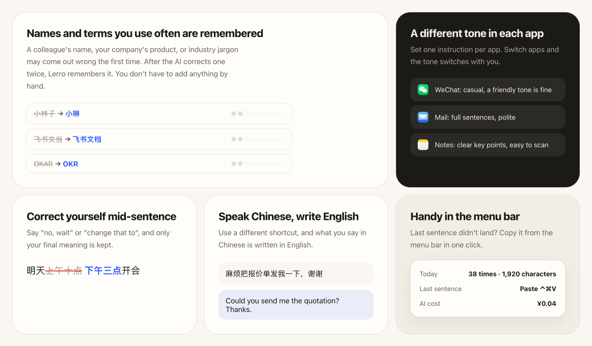

  

<h1 align="center">Speak it. It's written.</h1>

  English · <a href="README.md">简体中文</a>

  Reply on WeChat, write an email, or put together a weekly report: press a shortcut and talk. 
  Filler words are removed, corrections are applied, and punctuation and paragraphs are added for you.

  <a href="https://updates.lerroapp.com/download/macos/latest"><strong>Download Lerro for Mac</strong></a>
  · <a href="https://lerroapp.com/en">Website</a>
  · <a href="https://lerroapp.com/en/changelog">Changelog</a>

  macOS 26 · Apple silicon · Free, open source, no sign-up

## Three steps, then just talk

1. Download and drag **Lerro.app** to Applications.
2. Open it and allow two permissions: Microphone lets it hear you, Accessibility
   lets it type the text for you.
3. Press the shortcut (Fn by default) and start talking. Press again to finish,
   and the text appears at your cursor.

Wherever your cursor is, the text goes there: WeChat, Feishu, DingTalk, WeCom,
Mail, Notes, Word, WPS, your browser, ChatGPT and more. Speaking is 4x faster
than typing.

It works right after install and is completely free. Turn on AI cleanup if you
want smoother text.

## It remembers how you talk

- **Names and terms you use often are remembered.** A colleague's name, your
  company's product, or industry jargon may come out wrong the first time. After
  the AI corrects one twice, Lerro remembers it. You don't have to add anything
  by hand.
- **A different tone in each app.** Set one instruction per app. Switch apps and
  the tone switches with you, for example casual in WeChat and full sentences in
  Mail.
- **Correct yourself mid-sentence.** Say "no, wait" or "change that to", and only
  your final meaning is kept.
- **Speak Chinese, write English.** Use a different shortcut, and what you say in
  Chinese is written in English.
- **Handy in the menu bar.** Last sentence didn't land? Copy it from the menu bar
  in one click.

## Pricing

- **Free:** Apple's speech recognition on your Mac, so what you say is what's
  written. Works in every app. No sign-up, no usage limit.
- **With AI cleanup:** removes filler words, fixes typos, adds punctuation,
  changes tone per app, translates Chinese to English, and remembers words you
  use often. It uses your own DeepSeek account and charges by usage: about ¥1
  per 1,000 uses, or about ¥2 a month at a hundred or so dictations a day. You
  can see your balance and spending in Lerro.

Lerro itself has no membership or subscription. The app has a three-step guide:
open the DeepSeek site, top up, then create a key and paste it.

## Privacy

- Apple recognizes your speech on this Mac, and recordings are not saved by
  default.
- No account needed. Lerro has no server collecting your data.
- With AI cleanup on, only text is sent, and only to your own DeepSeek account.
  You can see what was sent in History.
- The code is open source, so anyone can inspect it.

Details are in the [Privacy Policy](PRIVACY.md).

## Install

1. [Download the latest signed and notarized build](https://updates.lerroapp.com/download/macos/latest).
2. Move **Lerro.app** to Applications and open it.
3. Follow the setup to allow Microphone and Accessibility.

Requires an Apple silicon Mac (M1 or later) with macOS 26 or later. Lerro updates
itself from inside the app.

## Build from source

See [Development](docs/development.md) for building, testing and releasing,
[Architecture](docs/architecture.md) for how the app is put together, and
[Contributing](CONTRIBUTING.md).

## License

Lerro is open source under [Apache-2.0](LICENSE). First-party documentation and
images use [CC BY 4.0](LICENSES/CC-BY-4.0.txt). See [TRADEMARKS.md](TRADEMARKS.md),
[NOTICE](NOTICE), and [THIRD_PARTY_NOTICES.md](THIRD_PARTY_NOTICES.md).
