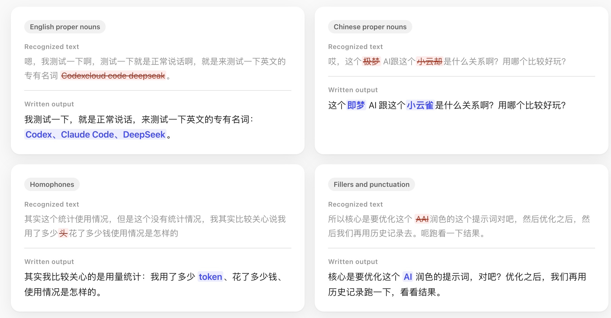
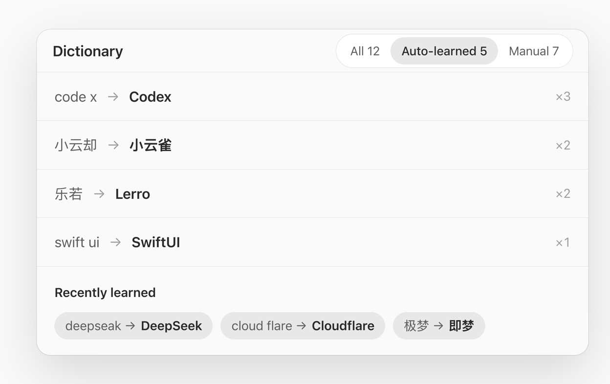

  

<h1 align="center">Speak it. It's written.</h1>

  English · <a href="README.zh-CN.md">简体中文</a>

  Press a shortcut and talk, press it again, and the text lands at your cursor. 
  Mix Chinese and English freely, and proper nouns come out right.

  <a href="https://updates.lerroapp.com/download/macos/latest"><strong>Download for macOS</strong></a>
  · <a href="https://lerroapp.com/en">Website</a>
  · <a href="https://lerroapp.com/en/changelog">Changelog</a>

  Free and open source · macOS 26 · Apple silicon

## How it works

1. Press your shortcut (Fn by default) and speak. A small capsule at the bottom
   of the screen shows the live transcript.
2. Press the shortcut again. Lerro writes the text into the field you were
   typing in.
3. If you switched away before it finished, Lerro stops, keeps the text on the
   clipboard, and offers to paste it.

Apple's on-device speech recognition does the listening. With AI polish turned
on, your own AI provider fixes misheard words using your dictionary, removes
fillers, and adds punctuation.

## A dictionary that learns

Names of people, companies, and projects are hard to recognize the first time.
When you correct a word Lerro wrote, the AI decides whether it was a
recognition error and adds it to the dictionary. Lerro can also scan your
history and list the words it keeps getting wrong, so you can add them with one
click.

Each app can also have its own tone, for example casual in chat and complete
sentences in email.

## AI polish with your own DeepSeek key

Lerro has no subscription. AI polish uses your own
[DeepSeek](https://platform.deepseek.com) account and costs about ¥1 per 1,000
dictations. Create an API key, then paste it in **Settings › Smart** and click
**Test Connection**. Settings › Usage shows what each request cost.

Without a key, Lerro still works: Apple recognition runs on your Mac for free
and the transcript is written as is.

## Privacy

- No account and no telemetry.
- Speech is recognized on your Mac. With AI polish on, only the recognized text
  goes to the provider you configured.
- Recordings are not saved unless you turn it on.

Details are in the [Privacy Policy](PRIVACY.md).

## Install

1. [Download the latest signed and notarized build](https://updates.lerroapp.com/download/macos/latest).
2. Move **Lerro.app** to Applications and open it.
3. Follow the setup to grant Microphone, Speech Recognition, and Accessibility.

Requires an Apple silicon Mac with macOS 26 or later. Lerro updates itself
from inside the app.

## Build from source

See [Build and testing](docs/build.md). Engineering docs:
[architecture](docs/architecture.md), [core flow](docs/core-flow.md),
[models and BYOK](docs/models.md), [privacy and security](docs/privacy-security.md),
and [contributing](CONTRIBUTING.md).

## License

Lerro is open source under [Apache-2.0](LICENSE). First-party documentation and
images use [CC BY 4.0](LICENSES/CC-BY-4.0.txt). See [TRADEMARKS.md](TRADEMARKS.md),
[NOTICE](NOTICE), and [THIRD_PARTY_NOTICES.md](THIRD_PARTY_NOTICES.md).
