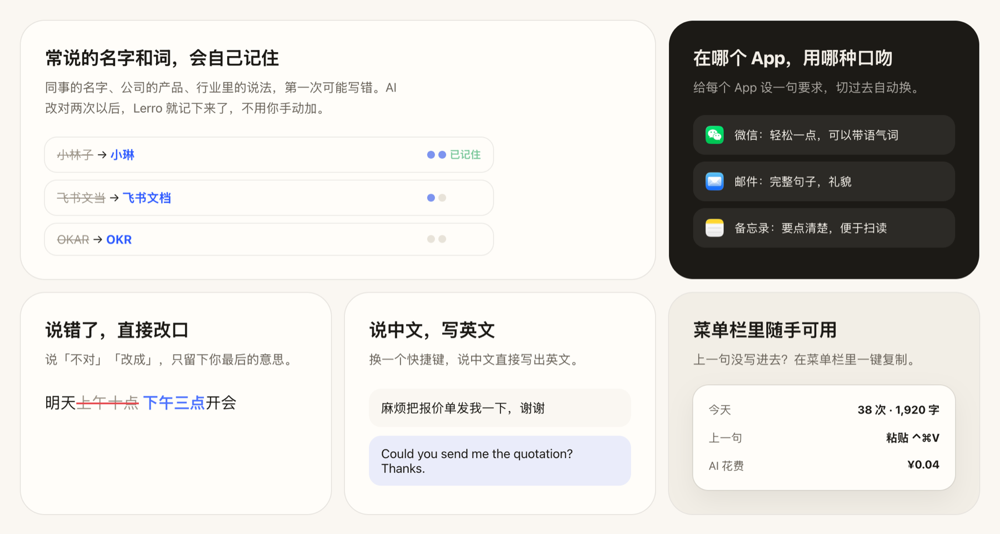

  

<h1 align="center">说出来，就写好了</h1>

  <a href="README.en.md">English</a> · 简体中文

  
  
  

  回微信、写邮件、整理周报，按一下快捷键说就行。 
  口头禅自动去掉，说错的地方自动改好，标点和分段也帮你加上。

  <a href="https://updates.lerroapp.com/download/macos/latest"><strong>免费下载 Mac 版</strong></a>
  · <a href="https://lerroapp.com">官网</a>
  · <a href="https://lerroapp.com/changelog">更新日志</a>

  macOS 26 · Apple 芯片 · 免费、开源、不用注册

  <strong>Typeless 和 Wispr Flow 的免费开源替代：声音在你的 Mac 本机识别，不用注册。</strong>

## 三步，开口就能用

1. 下载，把 **Lerro.app** 拖进「应用程序」。
2. 打开，允许两个权限：麦克风用来听你说话，辅助功能用来把字写进去。
3. 按一下快捷键（默认 Fn）开始说，再按一下结束，字就写在光标那里。

光标在哪儿，字就写到哪儿：微信、飞书、钉钉、企业微信、邮件、备忘录、Word、WPS、浏览器、ChatGPT 都能用。说话比打字快 4 倍。

装好就能用，完全免费。想让文字更通顺，再开一下 AI 整理。

## 越用越顺手

- **常说的名字和词，会自己记住**：同事的名字、公司的产品、行业里的说法，第一次可能写错。AI 改对两次以后，Lerro 就记下来了，不用你手动加。
- **在哪个 App，用哪种口吻**：给每个 App 设一句要求，切过去自动换。比如微信轻松一点，邮件用完整句子。
- **说错了，直接改口**：说「不对」「改成」，只留下你最后的意思。
- **说中文，写英文**：换一个快捷键，说中文直接写出英文。
- **菜单栏里随手可用**：上一句没写进去？在菜单栏里一键复制。

## 和 Typeless、Wispr Flow 比

| | Lerro | Typeless / Wispr Flow |
| --- | --- | --- |
| 价格 | 免费；开 AI 整理一个月 2 块钱左右 | 专业版一年 144 美元（约 1000 元）；免费版每周有字数上限 |
| 声音在哪识别 | 你的 Mac 本机 | 上传到云端识别 |
| 要不要注册 | 不用注册 | 要登录账号 |
| 代码 | 开源 | 不开源 |
| 平台 | 只有 Mac（macOS 26、Apple 芯片） | Mac、Windows、手机都有 |

竞品信息来自 [Typeless 定价](https://www.typeless.com/pricing)、[Typeless 隐私政策](https://www.typeless.com/privacy)、[Wispr Flow 定价](https://wisprflow.ai/pricing)、[Wispr Flow 隐私说明](https://wisprflow.ai/privacy)和两家的安装说明，2026 年 10 月 24 日核对。Typeless、Wispr Flow 是各自所有者的商标。

## 价格

- **基础版免费**：苹果本机识别，说什么写什么；所有 App 里都能用；不用注册，没有次数限制。
- **开启 AI 整理**：去掉口头禅、自动改错字、加标点，按 App 换口吻，中译英，常说的词会自己记住。用你自己的 DeepSeek 账号按用量付费，约 1000 次 1 块钱；每天说一百多次，一个月 2 块钱左右，余额和花费在 Lerro 里都看得到。

Lerro 本身没有会员和订阅。App 里有三步指引：打开 DeepSeek 官网、充值、创建并粘贴一串密钥，照着点就行。

## 隐私

- 语音由苹果在本机识别，录音默认不保存。
- 不用注册账号，Lerro 没有服务器收你的数据。
- 开了 AI 整理，只有文字会发给你自己的 DeepSeek 账号，每次发了什么都能在历史里看到。
- 代码开源，任何人都可以检查。

完整说明见[隐私政策](PRIVACY.md)。

## 安装

1. [下载最新的已签名、已公证版本](https://updates.lerroapp.com/download/macos/latest)。
2. 把 **Lerro.app** 拖到「应用程序」并打开。
3. 按引导允许麦克风和辅助功能。

需要 Apple 芯片（M1 及以后）的 Mac 和 macOS 26 或更新版本。之后的版本在 App 里就能更新。

## 从源码构建

构建、测试和发版见[开发指南](docs/development.md)，代码结构见[架构说明](docs/architecture.md)，参与贡献见 [CONTRIBUTING.md](CONTRIBUTING.md)。

## 许可

Lerro 以 [Apache-2.0](LICENSE) 开源。第一方文档和图片采用 [CC BY 4.0](LICENSES/CC-BY-4.0.txt)。另见 [TRADEMARKS.md](TRADEMARKS.md)、[NOTICE](NOTICE) 和 [THIRD_PARTY_NOTICES.md](THIRD_PARTY_NOTICES.md)。
