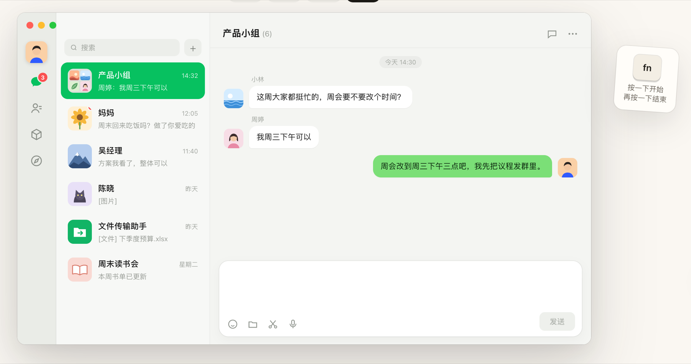
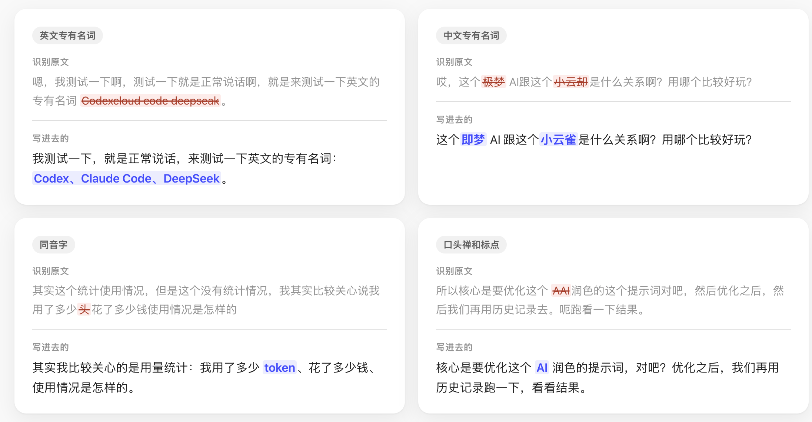
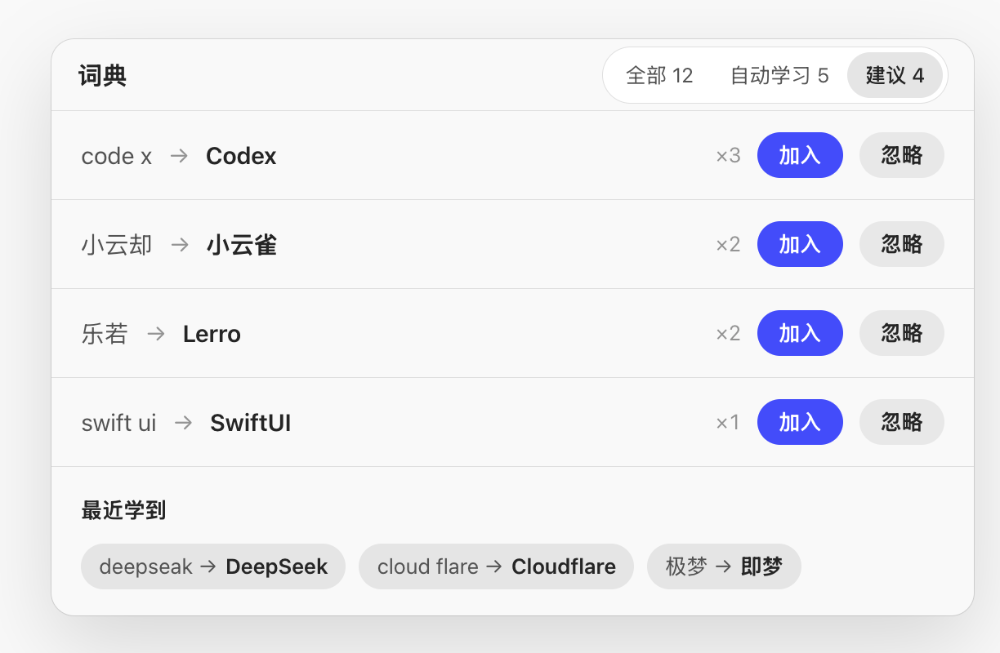

  

<h1 align="center">说出来，就写好了</h1>

  <a href="README.en.md">English</a> · 简体中文

  按一下快捷键说话，再按一下，文字写进光标所在的地方。 
  中英文混着说，专有名词也能写对。

  <a href="https://updates.lerroapp.com/download/macos/latest"><strong>下载 macOS 版</strong></a>
  · <a href="https://lerroapp.com">官网</a>
  · <a href="https://lerroapp.com/changelog">更新日志</a>

  免费开源 · macOS 26 · Apple 芯片

## 怎么用

1. 按下快捷键（默认 Fn）开始说话，屏幕下方的小胶囊会实时显示识别的文字。
2. 再按一下快捷键，Lerro 把文字写进你刚才所在的输入框。
3. 如果写入前你切走了，Lerro 会停下来，把结果留在剪贴板里，提示你粘贴。

语音由苹果在本机识别。打开 AI 整理后，DeepSeek 会按词典改掉认错的词，去掉“嗯”“呃”，补好标点。

## 词典会学

人名、公司名、项目名，苹果识别很难一次认对。你改掉 Lerro 写错的词，AI 判断是认错了，就会加进词典。

每个 App 还可以设置自己的语气，比如聊天里口语一些，邮件里用完整句子。

## 用你自己的 DeepSeek 账号做 AI 整理

Lerro 不收订阅费，AI 整理只支持 [DeepSeek](https://platform.deepseek.com)，走你自己的账号。App 里有三步指引：打开网站、充值、创建 Key 并粘贴，连上后会直接显示账户余额。每天说一百多次，一个月 2 块钱左右。

不开 AI 整理也能用：苹果本机识别，免费，识别结果直接写入。

## 隐私

- 不用注册账号，没有数据上报。
- 语音在本机识别。打开 AI 整理时，只有识别出的文字会发给 DeepSeek。
- 录音默认不保存，需要你在设置里打开。

完整说明见[隐私政策](PRIVACY.md)。

## 安装

1. [下载最新的已签名、已公证版本](https://updates.lerroapp.com/download/macos/latest)。
2. 把 **Lerro.app** 拖到“应用程序”并打开。
3. 按引导授权麦克风和辅助功能。

需要 Apple 芯片的 Mac 和 macOS 26 或更新版本。之后的版本在 app 里就能更新。

## 从源码构建

构建、测试和发版见[开发指南](docs/development.md)，代码结构见[架构说明](docs/architecture.md)，参与贡献见 [CONTRIBUTING.md](CONTRIBUTING.md)。

## 许可

Lerro 以 [Apache-2.0](LICENSE) 开源。第一方文档和图片采用 [CC BY 4.0](LICENSES/CC-BY-4.0.txt)。另见 [TRADEMARKS.md](TRADEMARKS.md)、[NOTICE](NOTICE) 和 [THIRD_PARTY_NOTICES.md](THIRD_PARTY_NOTICES.md)。
